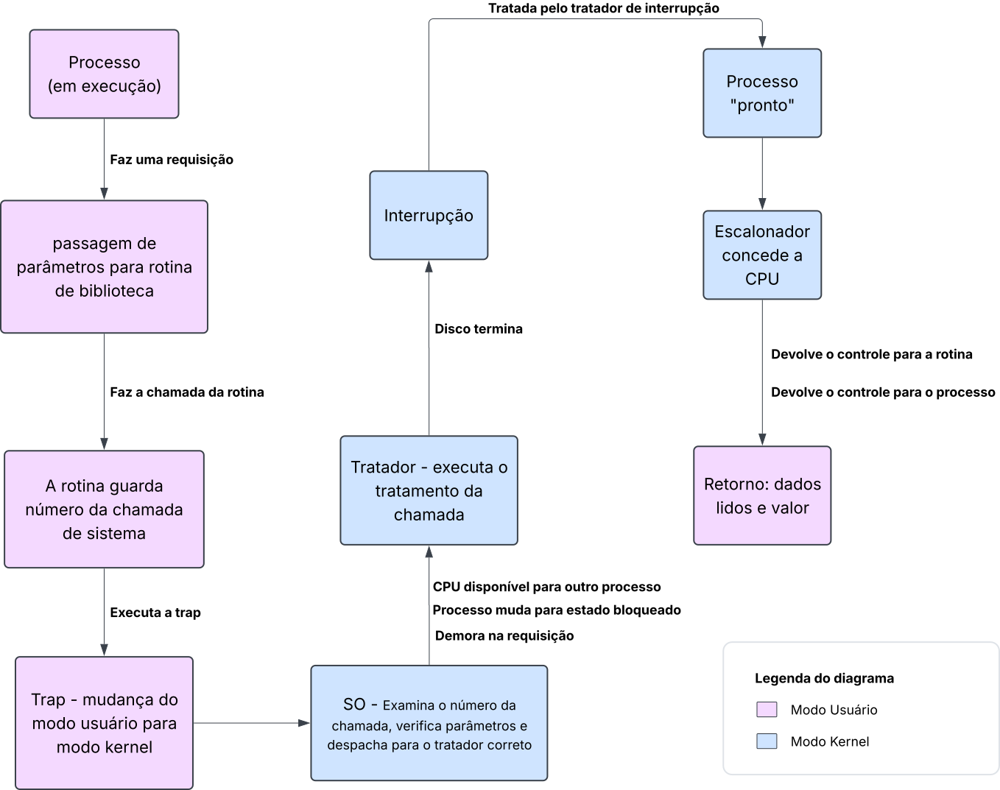

# Diário de Bordo: Encontro 6

**Disciplina:** Sistemas Operacionais 
**Tema:** Escalonador de Processos e Chamadas de Sistema (System Calls) 
**Aluna:** Nivea Sofia da Cas

## Parte A: Entendendo a Barreira do Sistema (Chamadas de Sistema)

### 1. Como o processo solicita essa leitura ao Sistema Operacional?

Quando o processo de geração de relatório precisa ler os dados financeiros no disco, ele não pode acessar o hardware diretamente. O processo passa os parâmetros para uma rotina de biblioteca e faz a chamada da rotina. A rotina, por sua vez, insere o número da chamada de sistema em um local que o sistema operacional consulta, como um registro, e em seguida executa uma instrução de armadilha (*trap*).

O sistema operacional (já no modo kernel) examina o número da chamada, verifica os parâmetros e descobre o que o processo que está chamando quer, então despacha para o tratador correto da chamada de sistema, que por fim executa o tratamento da chamada. Ao finalizar, o controle retorna para a rotina de biblioteca no modo usuário, que devolve o controle para o processo junto com o resultado (os dados lidos no buffer e o valor de retorno).

### 2. O que ocorre com o processo em termos de mudança de modo de acesso?

A *trap* executa a mudança do modo usuário (ring 3) para o modo kernel (ring 0, com todas as permissões). Durante a execução da chamada, o kernel identifica que há uma demora nessa requisição e muda o estado do processo para **bloqueado**. A CPU fica disponível para o escalonador alocar outro processo.

Quando o disco termina o trabalho dado a ele, o controlador de interrupção (hardware) avisa a CPU, que confirma a interrupção. Ela é então tratada pelo tratador de interrupção do sistema operacional, em modo kernel, que muda o processo para o estado de **pronto**. Quando o escalonador concede a CPU a ele novamente, o kernel retorna ao modo usuário (ring 3) e o processo continua a execução.

## Parte B: Diagnosticando o Escalonador

### 1. Por que o algoritmo FCFS está causando o "congelamento" da interface para os processos interativos?

No FCFS, os processos são atendidos estritamente pela ordem de chegada à fila de prontos, sem considerar o tamanho ou a urgência de cada tarefa. Quando um processo batch de geração de relatório chega primeiro e recebe a CPU, ele a mantém durante todo o seu tempo de processamento. As requisições web, que são curtas e precisam de resposta imediata, ficam paradas na fila de prontos esperando a vez, mesmo exigindo apenas alguns milissegundos de CPU.

Para o usuário, isso se manifesta como a interface "congelada" por vários segundos, pois o **tempo de resposta** do sistema se torna muito alto.

### 2. O que significa dizer que o FCFS é um algoritmo "Não Preemptivo" e como isso afeta a CPU neste cenário específico?

Um algoritmo **não preemptivo** é aquele em que o Sistema Operacional não pode retirar a CPU de um processo em execução. O processo só libera o processador quando termina, quando é bloqueado ao solicitar uma operação de E/S ou quando o libera voluntariamente. No FCFS não existe interrupção de relógio (*timer*) para limitar o tempo de uso da CPU por processo.

Neste cenário, mesmo que uma requisição interativa chegue e precise de resposta imediata, o escalonador não consegue interromper o processo batch para atendê-la. A CPU fica monopolizada pelo processo de relatório, e as tarefas interativas só serão executadas depois que ele terminar ou for bloqueado por E/S. 

## Parte C: Propondo a Solução

### 1. Qual algoritmo de escalonamento (SJF, SRTN ou Round-Robin) seria o mais adequado para resolver o problema de responsividade da interface web? Justifique tecnicamente como ele funciona.

**Round-Robin**, pois cada processo tem um tempo pré-determinado de uso da CPU, chamado de **QUANTUM**. O primeiro processo na fila é executado até atingir o QUANTUM (há exceções em que o tempo de execução é menor que o QUANTUM). Por conta de o Round-Robin ser preemptivo, ocorre uma interrupção de relógio, em que o sistema operacional faz a troca de contexto (salva o estado do processo e carrega o próximo), e então o processo retorna para a fila de prontos e o próximo processo da fila é executado. Todos os processos têm a oportunidade de utilizar a CPU por no máximo um QUANTUM.

Resolve o problema pois diminui o tempo de resposta da requisição web: ela não precisa aguardar o fim do relatório, apenas a volta na fila.

Os algoritmos SJF e SRTN não seriam indicados pois precisam conhecer o tempo de execução e a geração de relatório poderia cair em *starvation*, pois eles priorizam menor tempo de execução.

### 2. Se a empresa adotar um algoritmo de Prioridades, garantindo que a interface web tenha sempre prioridade máxima, os processos de relatório (batch) podem sofrer de Starvation (Inanição). O que é Starvation e qual mecanismo o Sistema Operacional pode usar para evitar esse problema?

***Starvation* (inanição)** é quando um processo de baixa prioridade nunca recebe a CPU porque há sempre processos de prioridade maior prontos. Assim, o processo de baixa prioridade fica sendo postergado indefinidamente, mesmo que ele não esteja bloqueado.

O mecanismo para resolver seria utilizar ***aging* (envelhecimento)**, aumentando gradualmente a prioridade dos processos que permanecem esperando há muito tempo na fila de prontos. Assim, o processo de relatório acaba atingindo prioridade suficiente para ser executado, mesmo com a chegada contínua de requisições web.

## Diagrama

     
    Fluxo de uma chamada de sistema de leitura em disco: modo usuário × modo kernel e estados do processo. 
    Fonte: elaborado pela autora (2026).

## Referências

### Texto

PRIORITY scheduling and aging. **AlgoMaster.io**: Operating Systems, [s. l.], atualizado em 14 ago. 2026. 
Disponível em: https://algomaster.io/learn/operating-systems/priority-scheduling-and-aging. Acesso em: 8 out. 2026.

TANENBAUM, Andrew S.; BOS, Herbert. **Sistemas operacionais modernos**. Tradução: Jorge Ritter. Revisão técnica: Raphael Y. de Camargo. 4. ed. São Paulo: Pearson Education do Brasil, 2016.

### Vídeo

PROF. SANTIAGO - PROGRAMAÇÃO E CIÊNCIA. **Me Salva Sistemas Operacionais: Algoritmo de Escalonamento Round-Robin**. [S. l.]: Prof. Santiago - Programação e Ciência, 20 nov. 2022. 1 vídeo (6 min). Publicado no YouTube. Disponível em: https://www.youtube.com/watch?v=EEe5nNfrBI0. Acesso em: 8 out. 2026.
